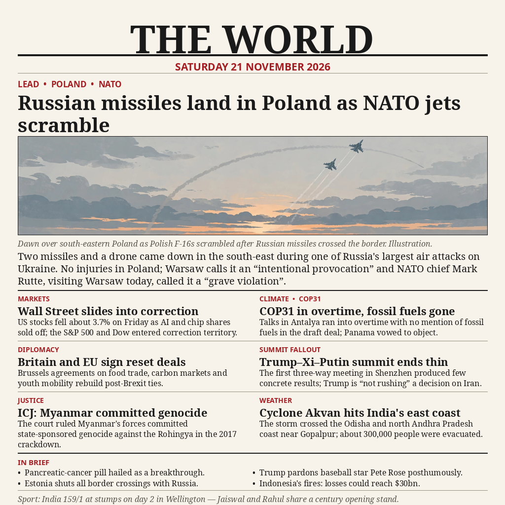

# THE WORLD — Saturday 21 November 2026

[](https://make.fun/bounty/news-image-20261121)
[](https://make.fun/bounty/news-image-20261121)
[](https://make.fun/bounty/news-image-20261121)

One 1024x1024 newspaper front page summing up the world news of Saturday
21 November 2026, built for make.fun's `news-image-20261121` bounty. The
image is drawn by `tools/render.py` (Python + PIL) from a researched news
brief; `main.ts` copies the finished page to the output directory.



## What's on the page

- **Lead — Russian missiles land in Poland.** Two missiles and a drone came
  down in south-eastern Poland during one of Russia's largest air attacks on
  Ukraine. Warsaw calls it an "intentional provocation"; Polish F-16s
  scrambled, NATO chief Mark Rutte called it a "grave violation" on his visit
  to Warsaw. The hero illustration shows dawn over eastern Poland with NATO
  jets scrambling under a missile trail.
- **Markets — Wall Street slides into correction.** US stocks fell about 3.7%
  on Friday as AI and chip shares sold off; the S&P 500 and the Dow entered
  correction territory.
- **Climate — COP31 in overtime, fossil fuels gone.** Talks in Antalya ran
  past Friday into Saturday with no mention of fossil fuels in the draft deal;
  Panama vowed to object.
- **Diplomacy — Britain and EU sign reset deals.** Brussels agreements on food
  trade, carbon markets and youth mobility rebuild post-Brexit ties.
- **Summit fallout — Trump–Xi–Putin summit ends thin.** The first three-way
  meeting in Shenzhen produced few concrete results; Trump is "not rushing" a
  decision on Iran.
- **Justice — ICJ: Myanmar committed genocide.** The court ruled Myanmar's
  forces committed state-sponsored genocide against the Rohingya in the 2017
  crackdown.
- **Weather — Cyclone Akvan hits India's east coast.** The storm crossed the
  Odisha and north Andhra Pradesh coast near Gopalpur; about 300,000 people
  were evacuated.
- **In brief:** a pancreatic-cancer pill hailed as a breakthrough; Trump
  pardons baseball star Pete Rose posthumously; Estonia shuts all border
  crossings with Russia; Indonesia's fires with losses that could reach $30bn.
  Sport: India 159/1 at stumps on day 2 in Wellington.

## Run it

```sh
mkdir -p out && MAKEFUN_OUTPUT_DIR=out node main.ts
```

This writes `out/entry.png` (1024x1024, under 1 MiB). Re-render the page
from the brief with:

```sh
python3 tools/render.py
```

The render is deterministic: it uses no clock, no randomness and no network,
so repeated runs produce identical bytes.
